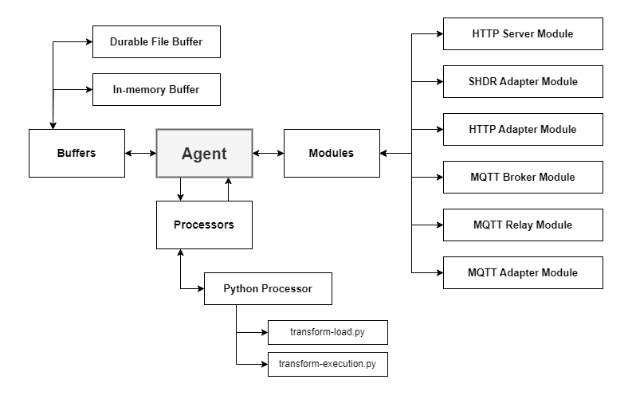
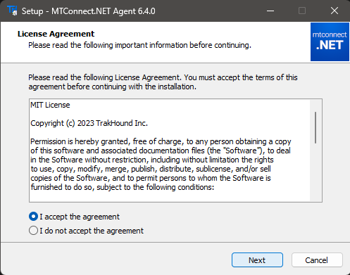
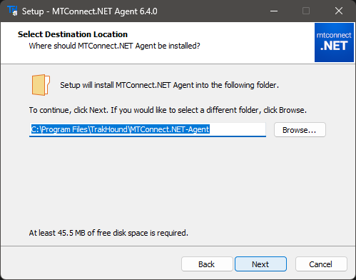
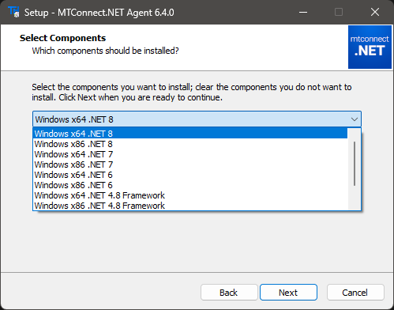
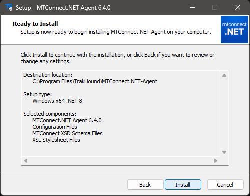
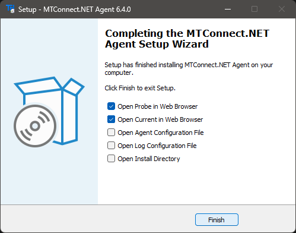
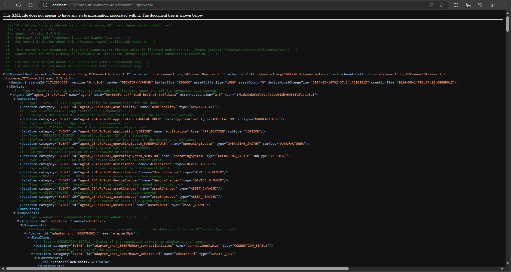
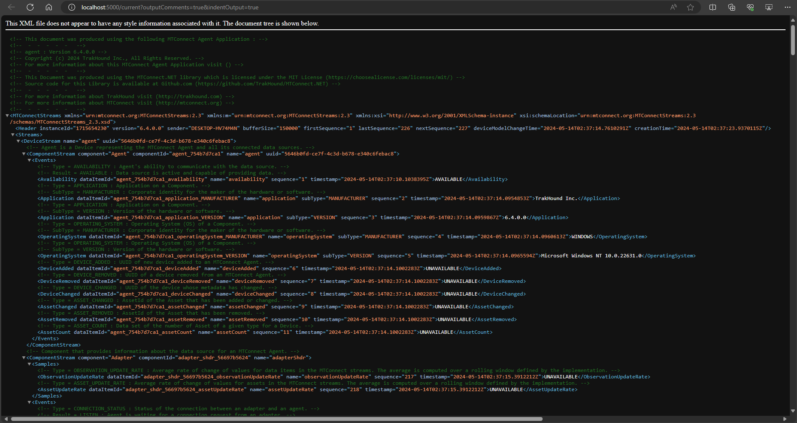

 

# MTConnect Agent

[](https://github.com/TrakHound/MTConnect.NET/actions/workflows/dotnet.yml)

## Download
<table>
    <thead>
        <tr>
            <th style="text-align: left;min-width: 100px;">Name</th>
            <th style="text-align: left;"></th>
            <th style="text-align: left;">Link</th>
        </tr>
    </thead>
    <tbody>
        <tr>
            <td>Installer</td>
            <td></td>
            <td><a href="https://github.com/TrakHound/MTConnect.NET/releases/latest">https://github.com/TrakHound/MTConnect.NET/releases/latest</a></td>
        </tr>
        <tr>
            <td>Linux</td>
            <td></td>
            <td><a href="https://github.com/TrakHound/MTConnect.NET/releases/latest">https://github.com/TrakHound/MTConnect.NET/releases/latest</a> (<a href="#linux-installation">install steps</a>)</td>
        </tr>
        <tr>
            <td>Docker</td>
            <td></td>
            <td><a href="https://hub.docker.com/repository/docker/trakhound/mtconnect.net-agent">https://hub.docker.com/repository/docker/trakhound/mtconnect.net-agent</a></td>
        </tr>
    </tbody>
</table>

## Overview
This project is a full implementation of an MTConnect Agent used to read data from industrial machine tools and devices. This MTConnect Agent application is fully compatible with the latest **Version 2.7 of the MTConnect Standard**.

#### Features
- Plugin architecture to support Http Server, Mqtt Broker, Mqtt Relay, SHDR Adapters, Web UI, etc.
- Processors for transforming input data using simple Python scripts
- Easy setup with Windows Installers, and Linux archives that install a systemd service
- Options to run as Windows Service or as a console application (typically for testing/debugging)
- Optional 'Durable' buffer used to retain the Agent data between application/machine restarts
- High performance / Low resource usage
- Flexible Device configurations (traditional 'devices.xml' file or 'devices' directory with individual Device files)
- On-Demand MTConnect Versioning allowing for older clients to request the version of MTConnect they are compatible with using HTTP Url parameters
- Configuration File monitoring to automatically restart the Agent upon configuration file changes
- Flexible Logging using NLog which can be used to output log information to separate files for easier analysis



## Capabilities
| Description                          | Supported          | Description                          | Supported          |
| :----------------------------------- |:------------------:| :----------------------------------- |:------------------:|
| MTConnect Probe                      | :white_check_mark: | HTTP Server                          | :white_check_mark: |
| MTConnect Current                    | :white_check_mark: | MQTT Server (Internal Broker)        | :white_check_mark: |
| MTConnect Sample                     | :white_check_mark: | MQTT Server (External Broker)        | :white_check_mark: |
| MTConnect Assets                     | :white_check_mark: | SHDR Adapters (Input Data)           | :white_check_mark: |
| MTConnect Interfaces                 | :white_check_mark: | HTTP Adapters (Input Data)           | :white_check_mark: |
| Configuration File Monitoring        | :white_check_mark: | MQTT Adapters (Input Data)           | :white_check_mark: |
| Unit Conversion                      | :white_check_mark: | XML Stylesheets                      | :white_check_mark: |
| Script Transformation (Python)       | :white_check_mark: | XML Static Files                     | :white_check_mark: |
| Windows Service                      | :white_check_mark: | XML Schemas                          | :white_check_mark: |
| Linux Supported                      | :white_check_mark: | XML Validation                       | :white_check_mark: |
| Durable File Buffer                  | :white_check_mark: | JSON (MTConnect.NET v5)              | :white_check_mark: |
| Debug Logging                        | :white_check_mark: | JSON (cppagent)                      | :white_check_mark: |
| MTConnect Entity Validation          | :white_check_mark: | TLS (HTTP & MQTT)                    | :white_check_mark: |


## Installation
Follow the steps below to install the MTConnect Agent application.

### Step #1
Read through the license agreement (MIT License) and click **"I accept the agreement"** if you agree with the terms.
Then click **"Next"** to proceed to the next page.
*For more information about the MIT license click [Here](https://choosealicense.com/licenses/mit/)*


 

### Step #2
Select the directory to install the application in using the **"Browse"** button or accept the default.
Then click **"Next"** to proceed to the next page.


 

### Step #3
Select the .NET version and Architecture (x64 or x86) to install the application for
Then click **"Next"** to proceed to the next page.


 

### Step #4
Review the list of components that will be installed and if correct then click **"Install"** to begin the installation.


 

### Step #5
Select the **"Open Probe in Web Browser"** and/or **"Open Current in Web Browser"** to view the Agent output and verify access 
Then click **"Next"** to proceed to the next page.


 

### Step #6
View the Probe and Current requests in a Web Browser
- [Probe - http://localhost:5000](http://localhost:5000/)
- [Current - http://localhost:5000/current](http://localhost:5000/current)

#### Probe Request
 

#### Current Request
 


## Linux Installation
Each release has an archive for 64-bit Linux : `mtconnect.net-agent-[version]-linux-x64.tar.gz` for x86_64, or `mtconnect.net-agent-[version]-linux-arm64.tar.gz` for aarch64 (ex. a Raspberry Pi with a 64-bit OS). It includes the .NET Runtime, so .NET doesn't need to be installed. Download it from the [latest release](https://github.com/TrakHound/MTConnect.NET/releases/latest), extract it and run `install.sh`, which installs the Agent as the systemd service `mtconnect.net-agent`:
```
tar -xzf mtconnect.net-agent-[version]-linux-x64.tar.gz
sudo bash mtconnect.net-agent/install.sh
```

The Agent is installed to `/opt/trakhound/mtconnect.net-agent`, with its configuration (`agent.config.yaml`, `NLog.config` and the `devices` directory), logs and buffers. It runs as the `mtconnect` user, which owns that directory. .NET needs ICU, so install your distribution's `libicu` package if `install.sh` asks for it.

- Change `agent.config.yaml` for your devices, then restart the service with `sudo systemctl restart mtconnect.net-agent`
- View the Probe at [http://localhost:5000](http://localhost:5000/) and the Web UI at [http://localhost:5080](http://localhost:5080/) (open the ports in the firewall to reach them from other computers)
- See the service's status with `systemctl status mtconnect.net-agent` and its output with `journalctl -u mtconnect.net-agent -f`
- To upgrade, run the same commands with a newer archive. The configuration, devices, processors, logs and buffers are kept
- To uninstall, run `sudo bash mtconnect.net-agent/install.sh --uninstall`, which removes the service and keeps `/opt/trakhound/mtconnect.net-agent`. Add `--purge` to also delete it and the `mtconnect` user

The `install`, `start`, `stop` and `remove` commands below are for the Windows Service. On Linux, use `systemctl`.


## Usage
The Agent can be run from a command line prompt or as a Windows Service using the format below:
```
agent [help|install|install-start|start|stop|remove|debug|trace|run|run-service|reset] [configuration_file]

--------------------

Options :

           help  |  Prints usage information
        install  |  Install as a Service
  install-start  |  Install as a Service and Start the Service
          start  |  Start the Service
           stop  |  Stop the Service
         remove  |  Remove the Service
          debug  |  Runs the Agent in the terminal (with verbose logging)
          trace  |  Runs the Agent in the terminal (with trace level logging)
            run  |  Runs the Agent in the terminal
    run-service  |  Runs the Agent as a Service
          reset  |  Clears the durable Observation and Asset buffers and their indexes

Arguments :
--------------------

  configuration_file  |  Specifies the Agent Configuration file to load
                         Default : agent.config.yaml
```

If no command is given, `run` is used. A relative `configuration_file` path is resolved against the executable's directory. If no `configuration_file` is given and a legacy `agent.config.json` file exists in the executable's directory, it is read and converted to `agent.config.yaml` on startup.

#### Example 1:
Install the Agent as a Windows Service (Note: requires Administrator Privileges)
```
agent install
```

#### Example 2:
Install the Agent as a Windows Service using the configuration file "agent-config.yaml" and Starts the service (Note: requires Administrator Privileges)
```
agent install-start agent-config.yaml
```

#### Example 3:
Starts the Windows Service (Note: requires Administrator Privileges)
```
agent start
```


## Configuration
More information about [Configurations](https://github.com/TrakHound/MTConnect.NET/tree/master/libraries/MTConnect.NET-Common/Configurations). The default configuration file is shown below :
```yaml
# - Device Configuration -
devices: devices

# - Processors -
processors:
- python: # - Add Python Processor
    directory: processors

# - Modules -
modules:

- web-ui: # - Add Web UI module (browse data and edit this configuration at http://localhost:5080)
    port: 5080

- http-server: # - Add HTTP Server module
    port: 5000
    indentOutput: true
    documentFormat: xml
    accept:
      text/xml: xml
      application/json: json
    responseCompression:
    - gzip
    - br
    files:
    - path: schemas
      location: schemas
    - path: styles
      location: styles
    - path: styles/favicon.ico
      location: favicon.ico

# - http-server: # - Add HTTP Server module
#     port: 5001
#     indentOutput: true
#     documentFormat: xml
#     accept:
#       text/xml: xml
#       application/json: json
#     responseCompression:
#     - gzip
#     - br
#     tls:
#       # pfx:
#       #   certificatePath: c:\test-cert\trakhound.pfx
#       #   certificatePassword: trakhound
#       pem:
#         certificateAuthority: c:\test-cert\rootCA.crt
#         certificatePath: c:\test-cert\trakhound.crt
#         privateKeyPath: c:\test-cert\trakhound.key
#         privateKeyPassword: trakhound
#     files:
#     - path: schemas
#       location: schemas
#     - path: styles
#       location: styles
#     - path: styles/favicon.ico
#       location: favicon.ico

# - mqtt-broker: # - Add MQTT Broker module (Document Structure)
#     port: 1883
#     currentInterval: 10000
#     sampleInterval: 500
#     documentFormat: JSON-CPPAGENT
#     topicPrefix: MTConnect/Document
#     topicStructure: Document

# - mqtt-broker: # - Add MQTT Broker module (Entity Structure)
#     port: 1883
#     currentInterval: 10000
#     sampleInterval: 500
#     documentFormat: JSON
#     topicPrefix: MTConnect/Entity
#     topicStructure: Entity

# - mqtt-broker: # - Add MQTT Broker module (TLS)
#     port: 8883
#     currentInterval: 10000
#     sampleInterval: 500
#     tls:
#       pem:
#         certificateAuthority: c:\test-cert\rootCA.crt
#         certificatePath: c:\test-cert\trakhound.crt
#         privateKeyPath: c:\test-cert\trakhound.key
#         privateKeyPassword: trakhound

- mqtt-relay: # - Add MQTT Relay module (Document Structure)
    server: localhost
    port: 1883
    durableRelay: false
    currentInterval: 10000
    sampleInterval: 500
    documentFormat: JSON-CPPAGENT-MQTT
    topicPrefix: MTConnect/Document
    topicStructure: Document

# - mqtt-relay: # - Add MQTT Relay module (Entity Structure)
#     server: localhost
#     port: 1883
#     durableRelay: true
#     currentInterval: 10000
#     sampleInterval: 500
#     documentFormat: JSON
#     topicPrefix: MTConnect/Entity
#     topicStructure: Entity

# - mqtt-relay: # - Add MQTT Relay module (TLS)
#     server: localhost
#     port: 8883
#     durableRelay: true
#     currentInterval: 10000
#     sampleInterval: 500
#     tls:
#       pem:
#         certificateAuthority: c:\test-cert\rootCA.crt
#         certificatePath: c:\test-cert\trakhound.crt
#         privateKeyPath: c:\test-cert\trakhound.key
#         privateKeyPassword: trakhound


- shdr-adapter: # - Add SHDR Adapter module for Device = Okuma and Port = 7878
    deviceKey: Okuma
    # hostname: localhost
    port: 7878
    heartbeat: 1000
    reconnectInterval: 1000
    connectionTimeout: 1000

- shdr-adapter: # - Add SHDR Adapter module for Device = Mazak and Port = 7879
    deviceKey: Mazak
    # hostname: localhost
    port: 7879
    heartbeat: 1000
    reconnectInterval: 1000
    connectionTimeout: 1000


# The maximum number of Observations the agent can hold in its buffer
observationBufferSize: 150000

# The maximum number of assets the agent can hold in its buffer
assetBufferSize: 1000

# Sets whether the Agent buffers are durable and retain state after restart
# durable: true
# durableBufferPath: C:\mtconnect\agent\buffer

# Disables the Agent Device
# enableAgentDevice: false

# Sets the default MTConnect version to output response documents for.
# defaultVersion: 2.3
```

#### Device Configuration

* `devices` - The Path to look for the file(s) that represent the Device Information Models to load into the Agent. The path can either be a single file or a directory. The path can be absolute or relative to the executable's directory. There is no default: if `devices` is not set, no Device files are loaded.

#### Processor Configuration

* `processors` - Contains configurations for Agent Processors (ex. `python`). These configurations are specific to the individual processors.

#### Module Configuration

* `modules` - Contains configurations for Agent Modules. These configurations are specific to the individual modules and may be customized for custom modules.

#### Agent Configuration

* `observationBufferSize` - The maximum number of Observations the agent can hold in its buffer. Default is `131072`.

* `assetBufferSize` - The maximum number of assets the agent can hold in its buffer. Default is `1024`.

* `durable` - Sets whether the Agent buffers are durable and retain state after restart. Default is `false`.

* `durableBufferPath` - The base path to the directory to write the buffer files to when `durable` is `true`

* `useBufferCompression` - Sets whether the durable Agent buffers use Compression. Default is `false`.

* `ignoreTimestamps` - Overwrite timestamps with the agent time. This will correct clock drift but will not give as accurate relative time since it will not take into consideration network latencies. This can be overridden on a per adapter basis. Default is `false`.

* `defaultVersion` - Sets the default MTConnect version to output response documents for. Default is the latest version supported (`2.7`).

* `sender` - Sets the `sender` attribute in the Header of response documents. Default is the host name of the machine the Agent is running on.

* `timeZoneOutput` - Sets the TimeZone to use when timestamps are output from the Agent

* `convertUnits` - Sets the default for Converting Units when adding Observations. Default is `true`.

* `ignoreObservationCase` - Sets the default for Ignoring the case of Observation values. Applicable values will be converted to uppercase. Default is `false`.

* `enableValidation` - Sets whether Observations are validated against their DataItem when they are added, and marked as valid or invalid in the output. Default is `false`.

* `inputValidationLevel` - Sets the default per-DataItem validation level applied when new Observations and Assets are added to the Agent. Governs `InvalidObservationAdded` and `InvalidAssetAdded`. 0 = Ignore, 1 = Warning, 2 = Remove, 3 = Strict. Default is `Warning`.

* `deviceValidationLevel` - Sets the default device-shape validation level applied while a Device is being added or normalised (Component, Composition, DataItem). Independent from `inputValidationLevel` — a common integrator profile is `inputValidationLevel: Strict` alongside `deviceValidationLevel: Warning`. Governs `InvalidComponentAdded`, `InvalidCompositionAdded`, `InvalidDataItemAdded`, and `InvalidDeviceAdded`. 0 = Ignore, 1 = Warning, 2 = Remove, 3 = Strict. Default is `Warning`.

* `allowEmptyResultForEnumEvents` - When `true`, preserves an empty Result verbatim on VALUE-representation EVENT DataItems whose Type has a controlled vocabulary (`EXECUTION`, `CONTROLLER_MODE`, `AVAILABILITY`, etc.). Default `false` coerces the empty Result to `UNAVAILABLE`. Free-form String and Numeric-typed Events are unaffected.

* `enableAgentDevice` - Sets whether the Agent Device is output. Default is `true`.

* `agentUuid` - Sets a static UUID to assign to the Agent Device. If not set, a UUID is resolved automatically.

* `monitorConfigurationFiles` - Sets whether Configuration files are monitored. If enabled and a configuration file is changed, the Agent will restart. Default is `true`.

* `configurationFileRestartInterval` - Sets the minimum time (in seconds) between Agent restarts when MonitorConfigurationFiles is enabled. Default is `2`.

* `enableMetrics` - Sets whether Agent Metrics are captured (ex. ObservationUpdateRate, AssetUpdateRate). Default is `true`.


#### Windows Service Configuration

* `serviceName` - Changes the service name when installing or removing the service. This allows multiple agents to run as services on the same machine.

* `serviceDisplayName` - Changes the display name of the service. This helps with identification when multiple agents run as services on the same machine.

* `serviceDescription` - Changes the description of the service.

* `serviceAutoStart` - Sets the Service Start Type. True = Auto | False = Manual. Default is `true`.


## Logging
Logging is done using [NLog](https://github.com/NLog/NLog) which allows for customized logging through the NLog.config file located in the application's install directory. The loggers are setup so that there is a separate logger for:
- **(application-logger)** Application startup, shutdown, and configuration
- **(agent-logger)** MTConnect Agent
- **(agent-metrics)** Agent Metrics (logged at the Debug level)
- **(agent-validation)** MTConnect Data Validation Errors
- **(modules.[id])** Modules. There is a logger for each module, named using the module's ID in lowercase with spaces replaced by dashes (ex. `modules.http-server`)
- **(processors.[id])** Processors. There is a logger for each processor, named the same way (ex. `processors.python-scripts`)

The default [NLog Configuration File](https://github.com/TrakHound/MTConnect.NET/blob/master/agent/MTConnect.NET-Agent/NLog.config) is shown below:

```xml
<?xml version="1.0" encoding="utf-8" ?>
<nlog xmlns="http://www.nlog-project.org/schemas/NLog.xsd" xmlns:xsi="http://www.w3.org/2001/XMLSchema-instance">

	<!-- the targets to write to -->
	<targets>

		<!--Console-->
		<target name="logconsole" xsi:type="Console" />

		<!--Application Log File-->
		<target xsi:type="File" name="application-file" fileName="logs\application-${shortdate}.log" maxArchiveFiles="90" archiveEvery="Day"
			layout="${longdate}|${event-properties:item=EventId_Id:whenEmpty=0}|${uppercase:${level}}|${logger}|${message} ${exception:format=tostring}" />
		
		<!--Agent Log File-->
		<target xsi:type="File" name="agent-file" fileName="logs\agent-${shortdate}.log" maxArchiveFiles="90" archiveEvery="Day"
			layout="${longdate}|${event-properties:item=EventId_Id:whenEmpty=0}|${uppercase:${level}}|${logger}|${message} ${exception:format=tostring}" />

		<!--Agent Validation Log File-->
		<target xsi:type="File" name="agent-validation-file" fileName="logs\agent-validation-${shortdate}.log" maxArchiveFiles="90" archiveEvery="Day"
			layout="${longdate}|${event-properties:item=EventId_Id:whenEmpty=0}|${uppercase:${level}}|${logger}|${message} ${exception:format=tostring}" />

		<!--Module Log File-->
		<target xsi:type="File" name="module-file" fileName="logs\${logger}-${shortdate}.log" maxArchiveFiles="90" archiveEvery="Day"
			layout="${longdate}|${event-properties:item=EventId_Id:whenEmpty=0}|${uppercase:${level}}|${logger}|${message} ${exception:format=tostring}" />

		<!--Processor Log File-->
		<target xsi:type="File" name="processor-file" fileName="logs\${logger}-${shortdate}.log" maxArchiveFiles="90" archiveEvery="Day"
			layout="${longdate}|${event-properties:item=EventId_Id:whenEmpty=0}|${uppercase:${level}}|${logger}|${message} ${exception:format=tostring}" />

	</targets>

	<!-- rules to map from logger name to target -->
	<rules>

		<!--Write to Console-->
		<logger name="*" minlevel="Info" writeTo="logconsole" />

		<!--Application Logger-->
		<logger name="application-logger" minlevel="Warning" writeTo="application-file" final="true" />

		<!--Agent Logger-->
		<logger name="agent-logger" minlevel="Warning" writeTo="agent-file" final="true" />
		
		<!--Agent Validation Logger (Used to log Data Validation Errors)-->
		<logger name="agent-validation" minlevel="Warning" writeTo="agent-validation-file" final="true" />
		
		<!--Module Logger-->
		<logger name="modules.*" minlevel="Warning" writeTo="module-file" final="true" />

		<!--Processor Logger-->
		<logger name="processors.*" minlevel="Warning" writeTo="processor-file" final="true" />

		<!--Skip non-critical Microsoft logs and so log only own logs (BlackHole) -->
		<logger name="Microsoft.*" maxlevel="Warning" final="true" />
		<logger name="System.Net.Http.*" maxlevel="Warning" final="true" />

	</rules>
</nlog>
```

## Build
This project can be built using a variety of options using the DotNet CLI `publish` command such as below:
```
dotnet publish -c:Release -f:net8.0 -r:win-x64 -p:PublishSingleFile=true -p:IncludeAllContentForSelfExtract=true --self-contained false
```

## Source Code
This project uses the MTConnect.NET-Applications-Agents library (available on [Nuget](https://www.nuget.org/packages/MTConnect.NET-Applications-Agents)) to create an MTConnect Agent application. More information about this library can be found [Here](https://github.com/TrakHound/MTConnect.NET/tree/master/agent/MTConnect.NET-Applications-Agents). The MTConnect.NET-Applications-Agents library makes creating an MTConnect Agent application simple as well as makes it easy to keep updated using Nuget. A fully functional MTConnect Application can be created in just a few lines of code.

## Contribution / Feedback
- Please use the [Issues](https://github.com/TrakHound/MTConnect.NET/issues) tab to create issues for specific problems that you may encounter 
- Please feel free to use the [Pull Requests](https://github.com/TrakHound/MTConnect.NET/pulls) tab for any suggested improvements to the source code
- For any other questions or feedback, please contact TrakHound directly at **info@trakhound.com**.

## License
This application and its source code is licensed under the [MIT License](https://choosealicense.com/licenses/mit/) and is free to use and distribute.
