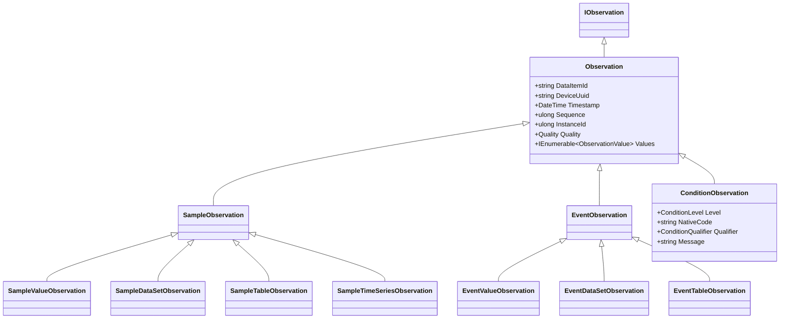

# Data items and observations

A **DataItem** is the primitive observable point on a [Device, Component](/concepts/devices#components) or [Composition](/concepts/devices#compositions). It does not carry a value — it declares the shape of values that the agent expects. An `AVAILABILITY` EVENT DataItem says "this point reports `AVAILABLE` or `UNAVAILABLE` over time"; a `POSITION` SAMPLE DataItem says "this point reports a numeric position over time with a configured unit". An **Observation** is one time-stamped value flowing through a DataItem: DataItems declare the shape, Observations carry the data.

`MTConnect.NET` represents a DataItem with the [`MTConnect.Devices.DataItem`](/api/MTConnect.Devices.DataItem) class implementing `IDataItem`, and ships one concrete subclass per spec-defined DataItem type. The concrete classes live in `libraries/MTConnect.NET-Common/Devices/DataItems/` and are generated from the MTConnect SysML model: `AvailabilityDataItem`, `PositionDataItem`, `EmergencyStopDataItem`, `AssetCountDataItem`, etc. Observations inherit from [`MTConnect.Observations.Observation`](/api/MTConnect.Observations.Observation) — see [Observations](#observations) below.

## Three categories

Every DataItem belongs to exactly one of three categories, defined in [`MTConnect.Devices.DataItemCategory`](/api/MTConnect.Devices.DataItemCategory):

- **`EVENT`** — a discrete-state observation. Values are strings (`READY`, `INTERRUPTED`, `AVAILABLE`) or numerics that do not interpolate. Examples: `AVAILABILITY`, `EMERGENCY_STOP`, `CONTROLLER_MODE`, `EXECUTION`. Source: MTConnect Standard `Part_2.0` Streams §3 ([docs.mtconnect.org](https://docs.mtconnect.org/)). See [Events](#events).
- **`SAMPLE`** — a continuous-time numeric observation. Values are scalars or vectors that have a unit and can be interpolated. Examples: `POSITION`, `TEMPERATURE`, `LOAD`, `SPINDLE_SPEED`. SAMPLE DataItems carry a `Units` attribute, an optional `NativeUnits` attribute, and an optional `SignificantDigits` attribute. See [Samples](#samples).
- **`CONDITION`** — an alarm-style observation that aggregates into a level: `NORMAL`, `WARNING`, `FAULT`, or `UNAVAILABLE`. Examples: `SYSTEM`, `LOGIC_PROGRAM`, `MOTION_PROGRAM`. See [Conditions](#conditions).

The category drives serialization shape (a `<Samples>` element wraps SAMPLE observations on the wire; a `<Events>` element wraps EVENT observations; a `<Condition>` element wraps CONDITION observations) and it drives which Observation subclass the runtime constructs.

## Identity attributes

```csharp
public partial class DataItem : IDataItem
{
    public string Id { get; set; }
    public string Name { get; set; }
    public string Type { get; set; }
    public string SubType { get; set; }
    public DataItemCategory Category { get; set; }

    public string Units { get; set; }
    public string NativeUnits { get; set; }
    public int? SignificantDigits { get; set; }

    public DataItemRepresentation Representation { get; set; }
    public DataItemStatistic Statistic { get; set; }
    public DataItemCoordinateSystem CoordinateSystem { get; set; }

    public IContainer Container { get; set; }
    public IDevice Device { get; set; }

    public virtual Version MinimumVersion { get; }
    public virtual Version MaximumVersion { get; }
}
```

- **`Id`** — locally unique within the Device. Required by the spec on the wire.
- **`Name`** — optional. Where present, the adapter line `LATHE.AXIS.X|<value>` resolves to a DataItem with `Name == "LATHE.AXIS.X"`. The SHDR adapter prefers `Name` lookup; the JSON consumer prefers `Id`.
- **`Type`** — the canonical type identifier in `UNDERSCORE_UPPER` form (`"AVAILABILITY"`, `"POSITION"`, `"EMERGENCY_STOP"`). The constant lives on the concrete class's `TypeId` field.
- **`SubType`** — refines the type. `POSITION` has subtypes `ACTUAL`, `COMMANDED`, `PROGRAMMED`, `TARGET`. `TEMPERATURE` has subtypes `ACTUAL`, `CALCULATED`.
- **`Category`** — EVENT / SAMPLE / CONDITION.
- **`Units`** — for SAMPLE DataItems. Canonical units are listed in the SysML model's `UnitsEnum` ([`mtconnect/mtconnect_sysml_model`](https://github.com/mtconnect/mtconnect_sysml_model)).
- **`Representation`** — `VALUE` (default), `DATA_SET`, `TABLE`, or `TIME_SERIES`. See [Representations](#representations) below.
- **`Container`** / **`Device`** — back-pointers to the Component / Device that owns the DataItem.

## Representations

`DataItemRepresentation` controls the shape of every observation that the DataItem produces:

- **`VALUE`** (default) — one scalar per observation. The wire shape is `<DataItem ...>scalar-value</DataItem>`.
- **`DATA_SET`** — a set of key-value entries per observation. Keys are spec-defined for some types (`PART_COUNT` discriminates `accepted`, `rejected`, `bad`) or adapter-defined for others. Wire shape: `<DataItem ...><Entry key="k1">v1</Entry><Entry key="k2">v2</Entry></DataItem>`.
- **`TABLE`** — entries-of-entries. Each top-level entry holds a sub-map. Used by `WORK_OFFSET_TABLE` and similar table-shaped DataItems.
- **`TIME_SERIES`** — a sample of values at a fixed cadence. Wire shape: `<DataItem ... sampleCount="N" sampleRate="freq">v1 v2 v3 ...</DataItem>`.

Representations are version-gated: `DATA_SET` enters the spec at v1.5, `TABLE` at v1.6, and the wire-shape rules for each are codified in `MTConnectStreams_<version>.xsd` ([schemas.mtconnect.org](https://schemas.mtconnect.org/)). The library's [Streams envelope](/wire-formats/) honours the gating when serializing a DataItem whose `Representation` is more recent than the requested response version. Each representation maps to its own Observation subclass (see [Samples](#samples) and [Events](#events)).

## Constructing DataItems

Three idiomatic constructors:

```csharp
using MTConnect.Devices;
using MTConnect.Devices.DataItems;

// 1. Typed — the recommended path. The DataItem subclass carries the
// canonical Type / Category / default Units, so the call site is succinct.
var avail = new AvailabilityDataItem("ctrl");

// 2. Untyped via the base DataItem constructor. The constructor takes
// category + type + subType + id; suitable for adapter-side dynamic models.
var custom = new DataItem(
    DataItemCategory.SAMPLE,
    "POSITION",
    "ACTUAL",
    "x-pos-actual");

// 3. The container shortcut — attach a typed DataItem to a Component or
// Composition by generic.
component.AddDataItem<TemperatureDataItem>();
```

Construction through a typed class is preferable because the class also carries the `DescriptionText`, `MinimumVersion`, and any default `Units` value from the SysML model. The shortcut form leaves those nulls and pushes the burden of correctness onto the caller.

## Filters, Constraints, Definitions

A DataItem can carry side metadata that refines what the agent emits:

- **`Filters`** — server-side filters that suppress observations. The two spec-defined filter types are `MINIMUM_DELTA` (only emit if `|new - last| > delta`) and `PERIOD` (emit at most once per period). Class: [`Filter`](/api/MTConnect.Devices.Filter); enum: [`DataItemFilterType`](/api/MTConnect.Devices.DataItemFilterType).
- **`Constraints`** — declared bounds and enumerated allowed values. `MAXIMUM`, `MINIMUM`, `VALUE` lists. Constraints are advisory in the spec — the agent emits values that violate the constraints, but consumers may flag them as alarms.
- **`Definition`** — for `DATA_SET` / `TABLE` representations, the structural definition of the entries and the cells. Class: [`DataItemDefinition`](/api/MTConnect.Devices.DataItemDefinition).
- **`ResetTrigger`** — for accumulators (`PART_COUNT`, `ACCUMULATED_TIME`), the lifecycle event that zeroes the accumulator: `SHIFT`, `DAY`, `MAINTENANCE`, and so on. Enum: [`DataItemResetTrigger`](/api/MTConnect.Devices.DataItemResetTrigger). The observation-side counterpart is described under [Reset triggers](#reset-triggers).
- **`Source`** — the SHDR / adapter key that maps incoming lines to this DataItem. Class: [`Source`](/api/MTConnect.Devices.Source).

## DataItem hashing and change detection

`DataItem.GenerateHash()` produces a SHA-1 hash over identity, category, type/subType, units, representation, statistic, coordinate-system, filter list, constraints, definition, and source. A change to any of those values changes the hash. The Device's hash includes every DataItem hash, so a single DataItem edit propagates up to the Device's `Hash` attribute on `/probe` — consumers detect that a model edit happened without re-parsing the full Devices document.

## Version gating

Like Components, every DataItem class carries `MinimumVersion` and `MaximumVersion`. `DataItem.Process(IDataItem, Version)` is the version-aware serializer; it strips properties added after the target version (for instance, `Statistic` is v1.2+; serializing for v1.1 elides it) and rejects DataItems whose `MinimumVersion` is above the target. Source: the SysML model's per-class introduction version, mirrored into the generated `.g.cs` files. Source-of-truth note: when the SysML model and the XSD disagree about a DataItem's introduction version, `MTConnect.NET` follows the SysML model — see [Compliance: Known divergences](/compliance/known-divergences) for the precedent.

## Observations

Every Observation is one of three concrete subclasses chosen by the DataItem's `Category`:

- [`SampleObservation`](/api/MTConnect.Observations.SampleObservation) for SAMPLE DataItems.
- [`EventObservation`](/api/MTConnect.Observations.EventObservation) for EVENT DataItems.
- [`ConditionObservation`](/api/MTConnect.Observations.ConditionObservation) for CONDITION DataItems.



Every Observation carries:

- **`DataItemId`** — must equal the `Id` of a DataItem present in the Device's model. The agent rejects observations whose `DataItemId` does not resolve.
- **`DeviceUuid`** — the owning Device's `Uuid`.
- **`Timestamp`** — when the value was observed. Encoded as UTC ISO 8601 on the wire, with optional fractional seconds (`2025-01-01T12:34:56.789Z`).
- **`Sequence`** — assigned by the agent as the observation enters the buffer. Monotonically increasing across the agent's lifetime; resets only on a buffer wipe. Consumers use Sequence to paginate `/sample` responses.
- **`InstanceId`** — the agent's instance identifier. A consumer that sees the instance change knows the agent restarted and the sequence numbers reset.
- **`Quality`** — optional. Carries data-quality annotation (`VALID`, `INVALID`, `QUESTIONABLE`, `OVERRANGE`). Enum source: SysML `QualityEnum`. Introduced in v2.3.
- **`Values`** — the value entries the Observation carries. For VALUE-representation observations there is one entry keyed `Result` (`ValueKeys.Result`); for DATA_SET / TABLE / TIME_SERIES the entries map to the spec-defined keys.

Observations are not usually constructed directly: an adapter or module hands the agent a value (or an `IObservationInput`) for a DataItem key, and the agent builds the Observation, assigns its `Sequence`, and appends it to the buffer.

## The Unavailable sentinel

The MTConnect Standard mandates that when an agent cannot determine a valid value for a DataItem, the result MUST be reported as the literal string `UNAVAILABLE`. The library makes this a first-class constant on [`Observation.Unavailable`](/api/MTConnect.Observations.Observation):

```csharp
public const string Unavailable = "UNAVAILABLE";
```

Every serializer, every codec, every Output transformer (under `MTConnect.NET-Common/Observations/Output/`) treats `Unavailable` as the canonical absent-value sentinel. Source: MTConnect Standard `Part_2.0` Streams §3 ([docs.mtconnect.org](https://docs.mtconnect.org/)).

### Value-class-aware empty-Result coerce

`MTConnectAgent.AddObservation` coerces a null, empty, or whitespace-only Result to `UNAVAILABLE` only when the DataItem's value class forbids the empty string. The classifier — [`DataItem.GetValueClass`](/api/MTConnect.Devices.DataItem) — returns one of three [`DataItemValueClass`](/api/MTConnect.Devices.DataItems.DataItemValueClass) values, each with a distinct policy:

| Value class | DataItems | Empty-Result behaviour |
| --- | --- | --- |
| **Numeric** | Every VALUE-representation SAMPLE (Part 2 — "Sample MUST always be reported in float") plus the numeric-typed VALUE-representation Events enumerated in the SysML model — `PART_COUNT`, `LINE_NUMBER`, `BLOCK_COUNT`, `HARDNESS`, `TOOL_OFFSET`, and kindred integer / float `result` attributes. | Always coerced to `UNAVAILABLE`. |
| **Enumeration** | VALUE-representation EVENT DataItems whose Type has a controlled vocabulary (`EXECUTION`, `CONTROLLER_MODE`, `AVAILABILITY`, and every other Event whose value is defined by an `MTConnect.Observations.Events.<Type>` enum). | Coerced to `UNAVAILABLE` by default. The [`IAgentConfiguration.AllowEmptyResultForEnumEvents`](/api/MTConnect.Configurations.IAgentConfiguration) flag (default `false`) preserves the empty Result when an integrator needs parity with adapters that emit empty values for these Events. |
| **String** | Free-form VALUE-representation EVENT DataItems (`PROGRAM`, `MESSAGE`, `TOOL_ID`, `ASSET_CHANGED`, and every other non-vocabulary Type); also SAMPLE or EVENT DataItems with a DATA_SET / TABLE / TIME_SERIES representation, whose structured payloads are outside the classifier's remit; also CONDITION observations (coercion is governed by `ConditionLevel`). | Never coerced. The standard's default value type for `Observation::result` is `string`, does not forbid the empty string, and the reference cppagent accepts empty strings for these Events. |

The classifier is representation-aware — DATA_SET / TABLE / TIME_SERIES inputs legitimately omit the Result key by design (they carry `Entries`, `Cells`, or `Samples` in dedicated value keys), so those observations pass through unchanged.

## Samples

A SAMPLE observation carries a numeric value plus the SAMPLE-specific metadata that the DataItem declares. The four concrete sample subclasses map to the four DataItem [Representation](#representations) modes:

- [`SampleValueObservation`](/api/MTConnect.Observations.SampleValueObservation) — one scalar, exposed as `Result` (`1.5` on the wire).
- [`SampleDataSetObservation`](/api/MTConnect.Observations.SampleDataSetObservation) — entries-of-scalars.
- [`SampleTableObservation`](/api/MTConnect.Observations.SampleTableObservation) — entries-of-entries-of-scalars.
- [`SampleTimeSeriesObservation`](/api/MTConnect.Observations.SampleTimeSeriesObservation) — a fixed-cadence vector. Carries `SampleCount` and `SampleRate` attributes.

A typical Sample in code — the agent resolves the DataItem by key and builds the `SampleValueObservation` itself:

```csharp
agent.AddObservation(device.Uuid, "x-pos-actual", 12.345, DateTime.UtcNow);
```

## Events

An EVENT observation carries a discrete-state value. The shape mirrors Samples — `EventValueObservation`, `EventDataSetObservation`, `EventTableObservation` — but the wire envelope groups them under `<Events>` rather than `<Samples>`. EVENT values are not numerically interpolated; consumers carry-forward the last known state until the next observation.

A canonical Event:

```csharp
agent.AddObservation(device.Uuid, "mill-01-avail", "AVAILABLE", DateTime.UtcNow);
```

## Conditions

A CONDITION observation aggregates alarm-style state into a level: `NORMAL`, `WARNING`, `FAULT`, or `UNAVAILABLE`. Conditions deviate from Samples and Events in two ways:

1. **Multiple actives**: a single CONDITION DataItem can hold many simultaneously-active condition observations, each keyed by `nativeCode`. Setting `NORMAL` with no `nativeCode` clears every active.
2. **Auxiliary attributes**: a Condition carries `nativeCode` (vendor's alarm code), `qualifier` (`HIGH` / `LOW`, from [`ConditionQualifier`](/api/MTConnect.Observations.ConditionQualifier)), `nativeSeverity`, and `message` (human-readable text).

Class shape:

```csharp
public class ConditionObservation : Observation, IConditionObservation
{
    public ConditionLevel Level { get; set; }     // NORMAL, WARNING, FAULT, UNAVAILABLE
    public string NativeCode { get; set; }
    public ConditionQualifier Qualifier { get; set; }
    public string NativeSeverity { get; set; }
    public string Message { get; set; }
}
```

A typical Condition lifecycle in code, using a `ConditionFaultStateObservationInput`:

```csharp
using MTConnect.Input;
using MTConnect.Observations;

// Raise a fault.
agent.AddObservation(device.Uuid, new ConditionFaultStateObservationInput("ctrl-system", ConditionLevel.FAULT, DateTime.UtcNow)
{
    NativeCode = "E1024",
    Qualifier = ConditionQualifier.HIGH,
    Message = "Spindle over-temperature",
});

// Clear all actives by sending NORMAL with no native code.
agent.AddObservation(device.Uuid, new ConditionFaultStateObservationInput("ctrl-system", ConditionLevel.NORMAL, DateTime.UtcNow));
```

Inside an agent module, `MTConnectInputAgentModule.AddConditionObservation(dataItemKey, level, ...)` wraps the same call.

Source: MTConnect Standard `Part_2.0` Streams §10 ([docs.mtconnect.org](https://docs.mtconnect.org/)); SysML `ConditionLevelEnum` ([`mtconnect/mtconnect_sysml_model`](https://github.com/mtconnect/mtconnect_sysml_model)).

## Reset triggers

For accumulator-shaped DataItems (`PART_COUNT`, `ACCUMULATED_TIME`, `MATERIAL_FEED`), Sample and Event observations carry an optional `ResetTriggered` field that marks the point at which the accumulator was zeroed. The values are spec-defined: `ACTION_COMPLETE`, `ANNUAL`, `DAY`, `MAINTENANCE`, `MANUAL`, `MONTH`, `POWER_ON`, `SHIFT`, `WEEK`. Enum source: SysML `ResetTriggeredEnum`. Consumers detect a reset event by observing the field set on an incoming observation, not by inferring a value drop.

## Sample vs Current vs Probe

The agent exposes three retrieval endpoints with different semantics:

- **`/probe`** — returns the Device model. No observations.
- **`/current`** — returns the most-recent observation per DataItem.
- **`/sample`** — returns every observation between `from` and `to` (or `count` after `from`), wrapping at the buffer's circular boundary if the range spans the wrap point.

The `Sequence` field is the cursor for `/sample`. A consumer that paginates calls `/sample?from=<lastSeen+1>&count=<batch>` and advances the `from` cursor with each batch. See [Wire formats](/wire-formats/) for the Streams envelope shape.

## Where to next

- [Devices and components](/concepts/devices) — the model tree that DataItems hang off.
- [Assets](/concepts/assets) — non-observation entities the device tracks.
- [Relationships](/concepts/relationships) — DataItem-to-DataItem references and how they thread through observations.
- [`IDataItem` API reference](/api/MTConnect.Devices.IDataItem) and [`IObservation` API reference](/api/MTConnect.Observations.IObservation).
- [Wire formats](/wire-formats/) — Observation serialization shapes per codec.
- [Cookbook: Write an agent](/cookbook/write-an-agent).
