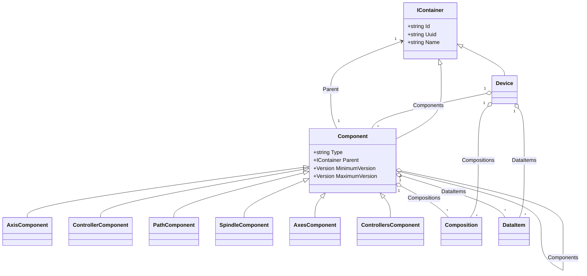

# Devices and components

A **Device** is the top-level addressable entity that an MTConnect Agent emits observations for. Conceptually it is "one machine" — a CNC mill, a robot cell, a coordinate-measuring machine, a vibration sensor cluster — and in `MTConnect.NET` it maps directly to the [`MTConnect.Devices.Device`](/api/MTConnect.Devices.Device) class implementing `IDevice`. Underneath it sits a tree of **Components** — the recursively-nested machine pieces such as an Axis, a Path, a Spindle, a Coolant subsystem or a Door — and, below those, finer-grained **Compositions**. Devices, Components and Compositions all carry the [DataItems](/concepts/data-items) that observe each piece.

## Identity and structure

A Device has three identity attributes, all required by the MTConnect Standard:

- **`Uuid`** — globally unique, set once when the model is authored and never re-generated. Consumers correlate observations across agent restarts on this field.
- **`Id`** — locally unique within the model tree. Used to address the Device in the path-query syntax (`/probe/<deviceUuid>` resolves the same node as `/probe?path=...//Device[@id='<id>']`).
- **`Name`** — display name. Free-form; not required to be unique across an installation.

The class signature is straightforward:

```csharp
public partial class Device : IDevice
{
    public const string TypeId = "Device";

    public string Uuid { get; set; }
    public string Id { get; set; }
    public string Name { get; set; }
    public string Type { get; set; }

    public IEnumerable<IComponent> Components { get; set; }
    public IEnumerable<IComposition> Compositions { get; set; }
    public IEnumerable<IDataItem> DataItems { get; set; }
}
```

The `Type` string defaults to `"Device"` and matches the `TypeId` constant the class exposes. Subtypes (such as the Agent's self-describing Device, where `Type == "Agent"`) carry their own `TypeId` and resolve to a distinct concrete class. The spec defines `Device` and `Agent` as the two concrete Device types in `Part_3.0` of the MTConnect Standard ([docs.mtconnect.org](https://docs.mtconnect.org/)); `MTConnect.NET` adds no third Device subtype beyond those.

## The Agent Device

When the agent boots it auto-registers a self-describing Device of type `"Agent"` — a `MTConnect.Devices.Agent` instance — that emits agent-introspection observations (`AVAILABILITY` for the agent itself, `ASSET_CHANGED`, `ASSET_REMOVED`, `MTCONNECT_VERSION`, and adapter / module health DataItems). Disable this with `enableAgentDevice: false` in `agent.config.yaml` when a consumer is strict about device counts. The Agent Device first appears in v1.7 of the Standard — the library emits no Agent Device when serializing for a version below `MTConnectVersions.Version17`, mirroring the version-gating in `Device.Process(IDevice, Version)`.

## Components

A Component nests under either a Device or another Component. The tree is unconstrained in depth; the MTConnect Standard does not cap it. `MTConnect.NET` represents a Component with the [`MTConnect.Devices.Component`](/api/MTConnect.Devices.Component) class implementing `IComponent`, and ships one concrete subclass per Component type defined in the MTConnect SysML model (`AxisComponent`, `ControllerComponent`, `LinearComponent`, `RotaryComponent`, `SpindleComponent`, and so on, generated from the SysML XMI into `.g.cs` files under `libraries/MTConnect.NET-Common/Devices/Components/`).

Every Component carries:

- **`Id`** — locally unique within the Device. Used to compose paths (`mill-01.path.axes.x`).
- **`Name`** — display name.
- **`Type`** — the `TypeId` of the concrete Component class (`"Axis"`, `"Controller"`, `"Spindle"`).
- **`Parent`** — the `IContainer` (Device or Component) that owns it.
- **`Components`** — children Components.
- **`Compositions`** — child [Compositions](#compositions).
- **`DataItems`** — DataItems attached directly to this Component.



The `Type` string is canonical — it is the camel-case `TypeId` constant on the concrete class — and matches the element name the XSD expects on the wire. `AxisComponent.TypeId == "Axis"`, `ControllerComponent.TypeId == "Controller"`, etc. The MTConnect SysML model is the source of truth for the Component class hierarchy ([`mtconnect/mtconnect_sysml_model`](https://github.com/mtconnect/mtconnect_sysml_model)); generated `.g.cs` files carry the `MinimumVersion` / `MaximumVersion` introducing each Component.

## Organizer Components

A few Components exist solely as containers for siblings of the same logical kind: an `Axes` Organizer holds `Axis` children, a `Controllers` Organizer holds `Controller` children, an `Auxiliaries` Organizer holds auxiliary subsystems. The MTConnect Standard treats Organizers as required wrappers — an `Axis` must live under an `Axes`, not directly under a `Device` — and `MTConnect.NET` enforces this in [`Device.AddComponent`](/api/MTConnect.Devices.Device) and `Component.AddComponent`: passing a non-organizer Component whose type has an associated Organizer triggers auto-creation of the Organizer wrapper if none is present.

```csharp
using MTConnect.Devices;
using MTConnect.Devices.Components;

var device = new Device { Id = "mill", Type = Device.TypeId };
var xAxis = new LinearComponent { Id = "x", Name = "X" };

device.AddComponent(xAxis);
// device.Components -> [AxesComponent { Id = "ax", Components = [xAxis] }]
// The Axes organizer was created automatically.
```

The Organizer lookup runs through [`MTConnect.Devices.Organizers`](/api/MTConnect.Devices.Organizers), a static table that maps a Component type to its required Organizer type. `IComponent.IsOrganizer` flags Organizer instances so traversal code can skip past them when presenting a "logical" device tree to a UI.

## Compositions

A **Composition** is a finer-grained part underneath a Component — the bearing inside an Axis, the chip conveyor inside a coolant system, the door panel inside a Door Component. Compositions exist from MTConnect v1.4 onward (the `Composition` class's `DefaultMinimumVersion` is `MTConnectVersions.Version14`), and they share the DataItem-bearing pattern with Components:

- A Composition has an `Id`, a `Name`, a `Type`, and a `DataItems` collection.
- A Composition has no nested `Components` — the tree of structural breakdown stops at the Composition level.
- A Composition has a `Parent` of type `IContainer`.

Compositions are valuable when the granularity below a Component is observable but does not warrant a full Component sub-tree. The classic case: a `LinearComponent` representing an axis has DataItems for `POSITION` and `LOAD`, but the axis's `Motor` Composition has its own `TEMPERATURE` DataItem. Modeling the motor as a Component would add nesting noise; a Composition is the right granularity.

```csharp
using MTConnect.Devices;
using MTConnect.Devices.Components;
using MTConnect.Devices.Compositions;
using MTConnect.Devices.DataItems;

var spindle = new SpindleComponent { Id = "spindle" };
var motor = new MotorComposition { Id = "motor", Name = "Spindle motor" };
motor.AddDataItem(new TemperatureDataItem(motor.Id));
spindle.AddComposition(motor);
```

The wire shape on `/probe` reflects the nesting:

```xml
<Spindle id="spindle">
  <Compositions>
    <Motor id="motor" name="Spindle motor">
      <DataItems>
        <DataItem category="SAMPLE" id="motor-temp" type="TEMPERATURE"/>
      </DataItems>
    </Motor>
  </Compositions>
</Spindle>
```

## Authoring a Device in code

The minimal in-code constructor produces a Device with a random `Id`, a random `Uuid`, and an empty tree:

```csharp
using MTConnect.Devices;
using MTConnect.Devices.Components;
using MTConnect.Devices.DataItems;

var device = new Device
{
    Id = "mill-01",
    Uuid = "1234-5678-9abc-def0",
    Name = "Mill #1",
    Type = Device.TypeId,
};

// Attach a Controller component and an AVAILABILITY data item.
var controller = new ControllerComponent { Id = "ctrl" };
controller.AddDataItem(new AvailabilityDataItem(controller.Id));
device.AddComponent(controller);
```

`AddComponent` is not just a list append: it creates any required Organizer wrapper on demand (see [Organizer Components](#organizer-components)). `AddDataItem` likewise does more than append — it assigns the data item's `Container` and re-runs the `DataItemIdFormat` template (`Component._defaultDataItemIdFormat`) to derive a deterministic Id.

## Authoring a Device in `Devices.xml`

For deployments that ship a static model alongside the agent, the canonical authoring path is an XML file that the agent reads at startup. The schema is the `MTConnectDevices_<version>.xsd` envelope from [schemas.mtconnect.org](https://schemas.mtconnect.org/). A minimal example:

```xml
<MTConnectDevices xmlns="urn:mtconnect.org:MTConnectDevices:2.5"
                  xmlns:xsi="http://www.w3.org/2001/XMLSchema-instance"
                  xsi:schemaLocation="urn:mtconnect.org:MTConnectDevices:2.5
                                      https://schemas.mtconnect.org/schemas/MTConnectDevices_2.5.xsd">
  <Header creationTime="2025-01-01T00:00:00Z" sender="agent-01"
          instanceId="1737504000" version="2.5.0.0" assetBufferSize="1024"
          assetCount="0" bufferSize="131072"/>
  <Devices>
    <Device id="mill-01" uuid="1234-5678-9abc-def0" name="Mill #1">
      <DataItems>
        <DataItem category="EVENT" id="mill-01-avail" type="AVAILABILITY"/>
      </DataItems>
      <Components>
        <Controller id="ctrl">
          <DataItems>
            <DataItem category="EVENT" id="ctrl-mode" type="CONTROLLER_MODE"/>
          </DataItems>
        </Controller>
      </Components>
    </Device>
  </Devices>
</MTConnectDevices>
```

The agent loads `Devices.xml` through the XML codec in `MTConnect.NET-XML` and validates it against the appropriate XSD. Validation failures are not silent — see [Troubleshooting: XSD validation failures](/troubleshooting/xsd-validation-failures) for the diagnostic flow.

## Device-tree traversal

`Device` and `Component` expose the same recursive traversal helpers, so a consumer can ask "every Component under me, regardless of depth" or "every DataItem matching this Type" without writing the recursion itself:

- `GetComponents()` — flat enumeration of every Component beneath this node.
- `GetComponent<TComponent>(name?, searchType?)` — typed lookup. `SearchType.Child` searches direct children; `SearchType.AnyLevel` (the default) searches the whole sub-tree.
- `GetCompositions()` / `GetComposition<TComposition>(...)` — same shape, Composition-typed.
- `GetDataItems()` — flat enumeration of every DataItem beneath this node, including those on its Compositions and recursive sub-Components.
- `GetDataItemByKey(key)` — resolves a DataItem by `Id`, then `Name`, then `Source.DataItemId`, then `Source.Value` — the same precedence the SHDR adapter uses when matching an incoming line to a target DataItem.
- `GetDataItemByType(typeId, subType?)` / `GetDataItem<TDataItem>(subType?)` — type-first lookup.

The recursive traversal respects Component nesting (an `Axis` under an `Axes` Organizer under a `Path` under the root Device is still reachable in a single `GetDataItems()` call). Typed lookup is the recommended path — the generic argument supplies the `TypeId` constant at the call site, without reflection:

```csharp
var spindle = device.GetComponent<SpindleComponent>();
var motorTemp = spindle.GetDataItem<TemperatureDataItem>();
```

## Version gating

Every Component class declares `MinimumVersion` and (optionally) `MaximumVersion`. When `Device.Process(IDevice, Version)` serializes the model for a target version, Components whose `MinimumVersion` is above the target are pruned and Components whose `MaximumVersion` is below the target are pruned. This is how the same model serves both a v1.6 consumer and a v2.5 consumer from one in-memory tree — the serializer prunes against the requested version's compatibility window, never against the model's declared version. The SysML model is consulted for every type's introduction version; see [Compliance: Spec cross-references](https://github.com/TrakHound/MTConnect.NET/blob/master/contributing/compliance/spec-cross-references.md) for the citation pattern.

## Device hashing

`Device.GenerateHash()` produces an SHA-1 hash over the Device's identity properties plus the hashes of every DataItem, Composition, and Component beneath it. Two Devices with identical models hash to identical strings; that hash drives the `deviceModelChangeTime` value that the agent advertises on `/probe`, and the v2.2+ Header's `Hash` attribute. Consumers detect a model change by comparing the cached hash against the live one, without diffing the full XML.

```csharp
var hashV1 = device.GenerateHash();
device.AddDataItem(new EmergencyStopDataItem("ctrl"));
var hashV2 = device.GenerateHash();
// hashV1 != hashV2 — the DataItem addition changed the device's identity.
```

## Where to next

- [Data items and observations](/concepts/data-items) — the primitive observable points hanging off Devices and Components, and the time-stamped values flowing through them.
- [Relationships](/concepts/relationships) — cross-Component links (parent, coordinate-system, ID-references).
- [`IDevice` API reference](/api/MTConnect.Devices.IDevice) and [`IComponent` API reference](/api/MTConnect.Devices.IComponent) — every property, every method.
- [Cookbook: Write an agent](/cookbook/write-an-agent) — a hands-on walk-through of building a model from scratch.
