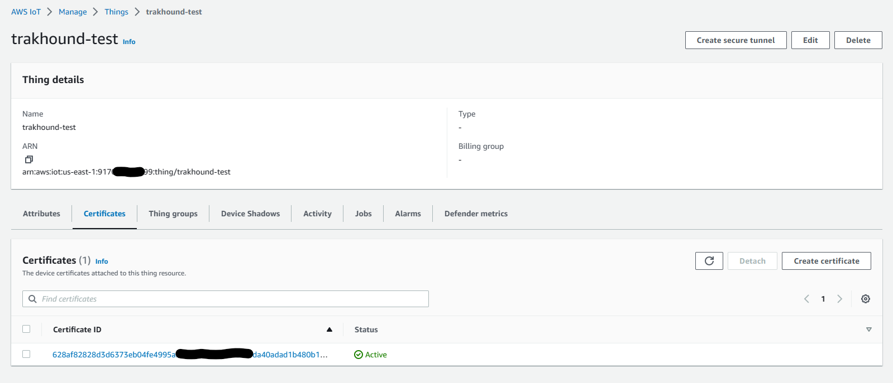
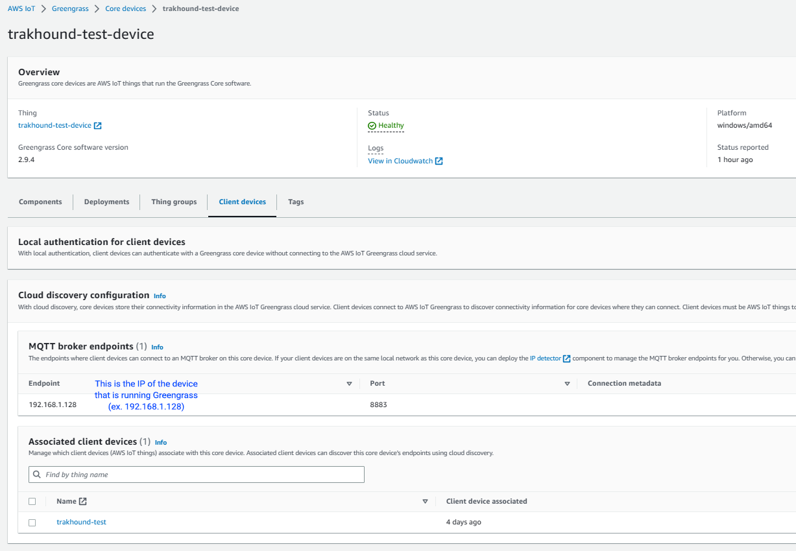

# Integrations

Short recipes for connecting an MTConnect.NET agent or client to third-party systems. Every MQTT recipe uses the [MQTT relay module](/modules/mqtt-relay) (`mqtt-relay`); see that page for the full key reference and [Configure the MQTT relay](/cookbook/configure-mqtt-relay) for a step-by-step walkthrough.

## InfluxDB

Uses `MTConnectHttpClient` to read from an MTConnect agent and write each observation to an InfluxDB bucket. The example covers plain value observations only; extend it for Conditions, DataSets, Tables, TimeSeries and Assets.

```c#
using InfluxDB.Client;
using InfluxDB.Client.Api.Domain;
using InfluxDB.Client.Writes;
using MTConnect.Clients;
using MTConnect.Observations;
using MTConnect.Streams;

var influxServer = "https://eastus-1.azure.cloud2.influxdata.com";
var influxToken = "<INFLUXDB_API_TOKEN>";
var influxOrganization = "example";

// Set up the InfluxDB client
var influxClient = new InfluxDBClient(influxServer, influxToken);

// Set up the MTConnect client (over HTTP)
var mtconnectClient = new MTConnectHttpClient("http://localhost:5000");
mtconnectClient.CurrentReceived += ObservationsReceived;
mtconnectClient.SampleReceived += ObservationsReceived;
mtconnectClient.Start();

Console.ReadLine();

mtconnectClient.Stop();

void ObservationsReceived(object sender, IStreamsResponseDocument response)
{
    using (var write = influxClient.GetWriteApi())
    {
        var records = new List<PointData>();

        foreach (var observation in response.GetObservations())
        {
            var key = $"{observation.DeviceUuid}.{observation.DataItemId}";
            records.Add(PointData.Measurement(key)
                .Field("value", observation.GetValue(ValueKeys.Result))
                .Timestamp(observation.Timestamp, WritePrecision.Us));
        }

        // Write the records to the "MTConnect.Streams" bucket
        write.WritePoints(records, "MTConnect.Streams", influxOrganization);
    }
}
```

## MQTT to AWS IoT

Publishes the agent's documents directly to AWS IoT Core.

- [Getting started with AWS IoT Core](https://docs.aws.amazon.com/iot/latest/developerguide/iot-gs.html) — AWS documentation for setting up the service and creating a Thing.
- [Video walkthrough](https://www.youtube.com/watch?v=Vk-fKN_81o8) — step by step (little or no audio).
- [MQTT Explorer](https://mqtt-explorer.com/) — a desktop client for browsing the broker's topics.

Notes:

- AWS IoT requires mutual TLS. Create the Thing's certificate in the AWS IoT console and download the device certificate, the private key and the Amazon root CA (`AmazonRootCA1.pem`) to the machine running the agent. The example below expects them in a `certs` directory next to the agent.
- AWS IoT allows at most 7 forward slashes in a topic name. With the default `topicStructure: Document`, topics are `<topicPrefix>/Current/<deviceUuid>` (and `Probe`, `Sample`, `Asset/<deviceUuid>/<assetId>`), so the limit is only reached with a long `topicPrefix`. `topicStructure: Entity` adds more levels (`<topicPrefix>/Devices/<deviceUuid>/Observations/<dataItemId>`), so keep the prefix to one or two levels when using it.

```yaml
modules:
  - mqtt-relay:
      server: a1b2c3d4e5f6g7-ats.iot.us-east-1.amazonaws.com
      port: 8883
      clientId: mtconnect-agent-01
      tls:
        pem:
          certificateAuthority: certs/AmazonRootCA1.pem
          certificatePath: certs/agent-certificate.pem.crt
          privateKeyPath: certs/agent-private.pem.key
```

## AWS Greengrass Moquette broker

Publishes to the MQTT 3.1.1 broker (Moquette) running on an AWS IoT Greengrass core device.

- [Getting started with AWS IoT Greengrass V2](https://docs.aws.amazon.com/greengrass/v2/developerguide/getting-started.html) — install the Greengrass core.
- [MQTT 3.1.1 broker (Moquette)](https://docs.aws.amazon.com/greengrass/v2/developerguide/mqtt-broker-moquette-component.html) — the broker component.

In the deployment configuration for the `aws.greengrass.clientdevices.mqtt.Moquette` component, enable the TLS port:

```json
"moquette": {
  "ssl_port": "8883"
}
```

Then point the relay at the core device. Set `clientId` to the name of the AWS Thing associated with the core device, and use that Thing's certificates:

```yaml
modules:
  - mqtt-relay:
      server: localhost
      port: 8883
      clientId: mtconnect-agent-01
      tls:
        pem:
          certificateAuthority: certs/AmazonRootCA1.pem
          certificatePath: certs/agent-certificate.pem.crt
          privateKeyPath: certs/agent-private.pem.key
```

The Thing's certificates in the AWS IoT console:



The Thing associated with the AWS core device:



## AWS Greengrass MQTT bridge

Forwards the relay's messages from the local Moquette broker on the Greengrass core to AWS IoT Core.

- [MQTT bridge](https://docs.aws.amazon.com/greengrass/v2/developerguide/mqtt-bridge-component.html) — the bridge component.

Set up the agent against the local broker first ([AWS Greengrass Moquette broker](#aws-greengrass-moquette-broker)) and the AWS IoT side as in [MQTT to AWS IoT](#mqtt-to-aws-iot). Then, in the deployment configuration for the `aws.greengrass.clientdevices.mqtt.Bridge` component, map the relay's topics (the default `topicPrefix` is `MTConnect`) to IoT Core:

```json
"mqttTopicMapping": {
  "MTConnectIotCoreMapping": {
    "topic": "MTConnect/#",
    "targetTopicPrefix": "mtconnect-agent-01/",
    "source": "LocalMqtt",
    "target": "IotCore"
  }
}
```

## MQTT to HiveMQ

Publishes to a HiveMQ broker (for example HiveMQ Cloud) with username and password over TLS.

- [HiveMQ getting started](https://www.hivemq.com/docs/hivemq/4.12/user-guide/getting-started.html#get-started)
- [MQTT Explorer](https://mqtt-explorer.com/) — a desktop client for browsing the broker's topics.

```yaml
modules:
  - mqtt-relay:
      server: a1b2c3d4e5f6.s1.eu.hivemq.cloud
      port: 8883
      username: exampleuser
      password: examplepassword
      useTls: true
```

## Create a self-signed certificate

For development, OpenSSL can generate a self-signed certificate and key for the agent's HTTPS or MQTTS endpoints:

```sh
openssl req -x509 -newkey rsa:2048 -keyout mtconnect.key -out mtconnect.crt -days 365 \
  -subj "/CN=localhost" -addext "subjectAltName=DNS:localhost,IP:127.0.0.1"
```

Add `-nodes` to leave the private key unencrypted; otherwise set the passphrase in the `pem` block's `privateKeyPassword`. Reference the files from a `tls` block:

```yaml
tls:
  pem:
    certificatePath: mtconnect.crt
    privateKeyPath: mtconnect.key
```

Clients must trust the certificate (or skip validation) for the handshake to succeed; see [MQTT TLS handshake failures](/troubleshooting/mqtt-tls-handshake).
