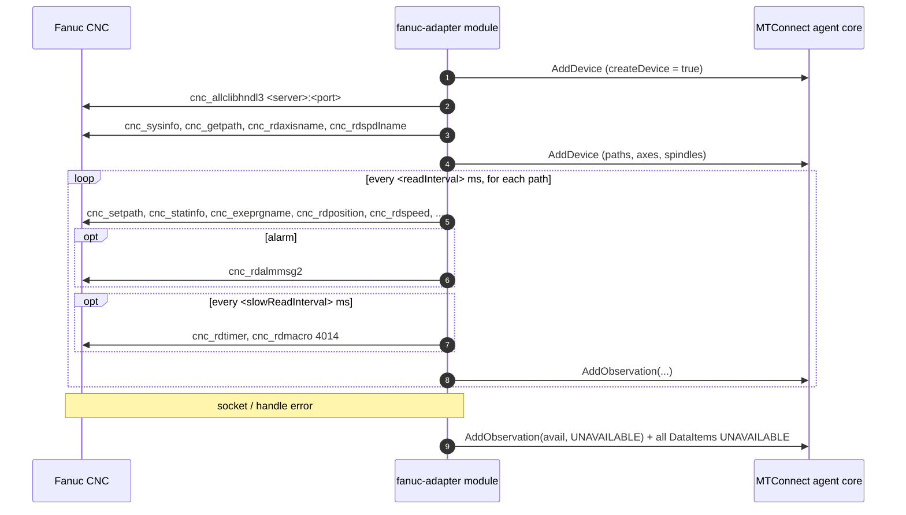

# Fanuc adapter

- **Module name** — MTConnect Fanuc Adapter agent module
- **Identifier** — `fanuc-adapter`
- **NuGet package** — `MTConnect.NET-AgentModule-FanucAdapter`
- **Source path** — `agent/Modules/MTConnect.NET-AgentModule-FanucAdapter/`

## Purpose

Reads a Fanuc CNC (Series 0i, 16i, 18i, 21i, 30i, 31i, 32i, 35i) directly using FOCAS over Ethernet and feeds the results into the agent, so no separate adapter process is needed. When the CNC connects, the module reads its model, paths, axes and spindles; by default it adds a Device built to match, including every path of multi-path controls.

::: warning FOCAS libraries
The Fanuc FOCAS libraries are not included. Copy `Fwlib64.dll` (64-bit agent) or `Fwlib32.dll` (32-bit agent), plus the series libraries they load (ex. `fwlib30i64.dll`, `fwlib0iD64.dll`), next to the agent executable. Without them an error is logged and the Device stays `UNAVAILABLE`.
:::

## Configuration schema

The module's configuration class is `FanucAdapterModuleConfiguration`. The keys below describe the YAML map under `fanuc-adapter:`.

| Key | Type | Default | Permissible values | Notes |
| --- | --- | --- | --- | --- |
| `deviceKey` | string | `null` | device name or UUID | Required. The Device observations are added to. |
| `createDevice` | bool | `true` | `true`, `false` | When `true`, the module adds a Device named `deviceKey`, updated with the structure read from the CNC. Set `false` to use a Device from `Devices.xml`. |
| `deviceUuid` | string | `deviceKey` | any string | UUID of the Device created when `createDevice` is `true`. |
| `server` | string | `localhost` | hostname or IP address | The CNC address. |
| `port` | int | `8193` | 1-65535 | The CNC's FOCAS port. |
| `responseTimeout` | int | `5000` | milliseconds | FOCAS communication timeout, rounded up to whole seconds. |
| `readInterval` | int | `1000` | milliseconds | Delay between read cycles. |
| `slowReadInterval` | int | `10000` | milliseconds | Interval between reads of the timers and the work offset. |
| `workPositions` | bool | `false` | `true`, `false` | Also report absolute (work coordinate) positions. |
| `axisLoads` | bool | `true` | `true`, `false` | Read the servo load of each axis. |
| `spindleLoad` | bool | `true` | `true`, `false` | Read the spindle load. |
| `overrides` | bool | `true` | `true`, `false` | Read the feedrate, rapid and spindle overrides from the CNC interface signals G0012, G0014, G0030 and G0096. |
| `toolNumberVariable` | int | `4120` | macro variable, `0` = off | The variable read for the tool number. #4120 is the modal T code; many machines keep the tool in the spindle in another variable. |
| `workOffset` | bool | `true` | `true`, `false` | Read the active work offset from #4014. |
| `partCountParameter` | int | `6711` | parameter, `0` = off | The parameter read for the part count. |

## DataItems

When `createDevice` is `false`, the Device in `Devices.xml` needs DataItems whose `id` or `name` match these keys. Path keys are used as-is for path 1 and prefixed with `p{n}_` for other paths (ex. `p2_execution`). Axis keys use the axis name read from the CNC, including its suffix (ex. `x_act`, `x1_act`).

### Read every cycle

| Key | DataItem | FOCAS source |
| --- | --- | --- |
| `avail` | `AVAILABILITY` | `AVAILABLE` while connected; otherwise `UNAVAILABLE` (and every other DataItem is set `UNAVAILABLE`). |
| `estop` | `EMERGENCY_STOP` | `cnc_statinfo` |
| `mode` | `CONTROLLER_MODE` | `cnc_statinfo` — MEM / RMT = `AUTOMATIC`, MDI = `MANUAL_DATA_INPUT`, EDIT = `EDIT`, JOG / HANDLE / INC / REF = `MANUAL`. |
| `execution` | `EXECUTION` | `cnc_statinfo` — reset = `READY`, START = `ACTIVE`, HOLD = `FEED_HOLD`, STOP = `STOPPED`, MSTR = `INTERRUPTED`; `STOPPED` in emergency stop. |
| `program` | `PROGRAM` | `cnc_exeprgname` (`cnc_rdprgnum` on older controls). |
| `line` | `LINE_LABEL` | `cnc_rdseqnum` — the sequence number (N). |
| `partCount` | `PART_COUNT` | `cnc_rdparam` 6711. |
| `tool` | `TOOL_NUMBER` | `cnc_rdmacro` 4120. |
| `feedrate` | `PATH_FEEDRATE` (`ACTUAL`) | `cnc_rdspeed` — mm/s; feed per revolution is converted using the spindle speed. |
| `feedOverride` | `PATH_FEEDRATE_OVERRIDE` (`PROGRAMMED`) | G0012 (*FV0 - *FV7). |
| `rapidOverride` | `PATH_FEEDRATE_OVERRIDE` (`RAPID`) | G0014 (ROV1, ROV2), or G0096 (1% rapid override) when HROV is on. |
| `system` | `SYSTEM` condition | `cnc_rdalmmsg2` — one `FAULT` per active alarm with its native code (ex. `PS0010`, `SV0401`) and message; `WARNING` for battery, fan and other warnings. |
| `speed` | `ROTARY_VELOCITY` (`ACTUAL`) | `cnc_rdspeed` (`cnc_acts` on older controls) — RPM. |
| `spindleLoad` | `LOAD` | `cnc_rdspmeter` — percent. |
| `spindleOverride` | `ROTARY_VELOCITY_OVERRIDE` | G0030 (SOV0 - SOV7). |
| `{axis}_act` | `POSITION` / `ANGLE` (`ACTUAL`) | `cnc_rdposition` — machine position, mm (inch converted) or degrees. |
| `{axis}_work` | `POSITION` / `ANGLE` (`ACTUAL`) | `cnc_rdposition` — absolute position, when `workPositions` is `true`; references the Device's `work` coordinate system (type `OBJECT`). |
| `{axis}_load` | `LOAD` | `cnc_rdsvmeter` — percent. |

The CNC interface (G) addresses are offset by 1000 per path (ex. G1012 for path 2).

### Read every `slowReadInterval`

| Key | DataItem | FOCAS source |
| --- | --- | --- |
| `firmware` | `FIRMWARE` (`VERSION`) | `cnc_sysinfo` — series and version. |
| `powerOnTime` | `EQUIPMENT_TIMER` (`POWERED`) | `cnc_rdtimer` 0 — seconds. |
| `operatingTime` | `EQUIPMENT_TIMER` (`OPERATING`) | `cnc_rdtimer` 1 — seconds. |
| `cuttingTime` | `EQUIPMENT_TIMER` (`WORKING`) | `cnc_rdtimer` 2 — seconds. |
| `cycleTime` | `PROCESS_TIMER` (`PROCESS`) | `cnc_rdtimer` 3 — seconds. |
| `workOffset` | `WORK_OFFSET` | `cnc_rdmacro` 4014 — ex. `54`. |

## Wire interaction



All FOCAS calls run on a dedicated thread, because a FOCAS library handle is only valid in the thread that opened it.

## Example configuration

```yaml
modules:
  - fanuc-adapter:
      deviceKey: M1
      server: 192.168.1.70
      port: 8193
```

With work positions and a machine-specific tool variable:

```yaml
modules:
  - fanuc-adapter:
      deviceKey: VMC-1
      server: 192.168.1.71
      workPositions: true
      toolNumberVariable: 500
```

For multiple machines, declare the module once per machine. Created DataItem IDs are prefixed with the Device name, so they do not collide.

## Troubleshooting

- **`FOCAS library not found`** — copy `Fwlib64.dll` / `Fwlib32.dll` and the series libraries next to the agent; the library bitness must match the agent process.
- **Always `UNAVAILABLE` with `return code -16`** — the CNC is not reachable on `port`, or FOCAS is not enabled on its Ethernet port.
- **A value never appears** — the CNC may not support that FOCAS function or option (logged once as "not supported"); check the agent log at `Information` level.
- **Wrong tool number** — #4120 is the commanded T code; on machining centers the tool in the spindle is often kept in a machine-specific macro variable. Set `toolNumberVariable`.
- **Override values look wrong** — the overrides come from the standard CNC interface signals; check them against the PMC signal status screen.
- **Observations dropped with `createDevice: false`** — the Device's DataItem `id` or `name` must match the keys above; verify against `/probe`.

## API reference

- [`FanucAdapterModuleConfiguration`](/api/MTConnect.Configurations.FanucAdapterModuleConfiguration) — the module's configuration class.
- [`IFocasClient`](/api/MTConnect.Fanuc.IFocasClient) — the FOCAS functions used by the module.
