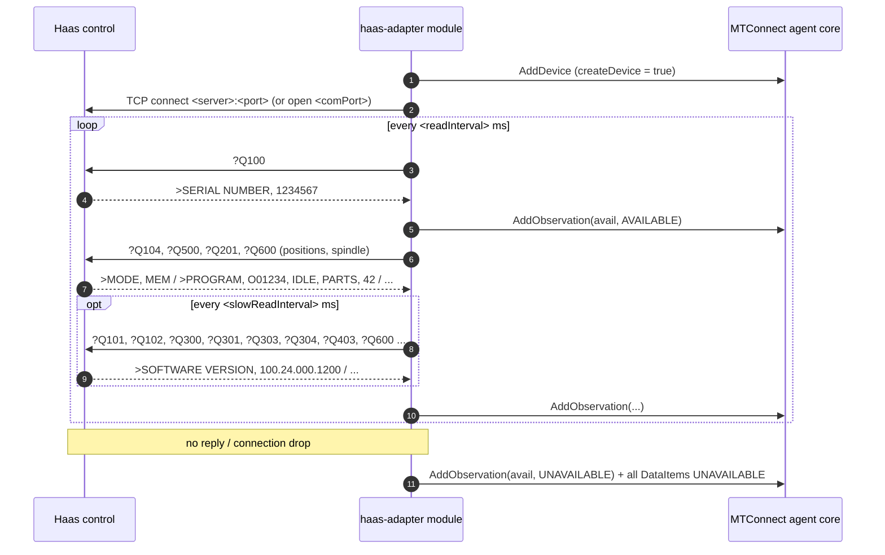

# Haas adapter

- **Module name** — MTConnect Haas Adapter agent module
- **Identifier** — `haas-adapter`
- **NuGet package** — `MTConnect.NET-AgentModule-HaasAdapter`
- **Source path** — `agent/Modules/MTConnect.NET-AgentModule-HaasAdapter/`

## Purpose

Reads a Haas CNC control (including the Haas Next Generation Control) directly over Ethernet or RS-232 using Haas Machine Data Collection — the `?Q` query commands — and feeds the results into the agent, so no separate adapter process is needed. By default the module also adds a Device model containing the DataItems it reports, and fills in its Description with the model and serial number read from the control.

Machine Data Collection is enabled on the control by setting **Setting 143** to the TCP port to use (ex. `5051`). Ports 8082 and 9090 - 9999 are used by the control and must not be used.

::: tip NGC built-in agent
NGC controls also include a built-in MTConnect agent on port 8082 (`http://<ip>:8082/<model>/current`; software 100.20.000.1200 or higher recommended). It can be read with the [HTTP adapter](./http-adapter) module instead of, or alongside, this module.
:::

## Configuration schema

The module's configuration class is `HaasAdapterModuleConfiguration`. The keys below describe the YAML map under `haas-adapter:`.

| Key | Type | Default | Permissible values | Notes |
| --- | --- | --- | --- | --- |
| `deviceKey` | string | `null` | device name or UUID | Required. The Device observations are added to. |
| `createDevice` | bool | `true` | `true`, `false` | When `true`, the module adds a Device named `deviceKey` with the DataItems below. Set `false` to use a Device from `Devices.xml`. |
| `deviceUuid` | string | `deviceKey` | any string | UUID of the Device created when `createDevice` is `true`. |
| `connection` | string | `ethernet` | `ethernet`, `serial` | How the module connects to the control. |
| `readInterval` | int | `1000` | milliseconds | Delay between read cycles. |
| `slowReadInterval` | int | `10000` | milliseconds | Interval between reads of slowly changing values (timers, counters, version, work offset, single block / optional stop). |
| `responseTimeout` | int | `2000` | milliseconds | Maximum time to wait for a reply. The first `?Q100` after connecting is resent once if unanswered; any other timeout closes the connection, which is reopened on the next cycle. |
| `units` | string | `mm` | `mm`, `inch` | The units the control reports linear positions in (Setting 9). Inch values are converted to millimeters. |
| `axes` | list | `[X, Y, Z]` | `X`, `Y`, `Z`, `A`, `B`, `C` | The axes to read positions for. |
| `workPositions` | bool | `false` | `true`, `false` | Also read work coordinate positions. |
| `spindleLoad` | bool | `true` | `true`, `false` | Read the spindle load (machines with a Haas vector drive). |
| `coolantLevel` | bool | `false` | `true`, `false` | Read the coolant level (machines with a coolant level sensor). |
| `server` | string | `localhost` | hostname or IP address | Ethernet only. |
| `port` | int | `5051` | 1-65535 | Ethernet only. The port set in Setting 143. |
| `connectionTimeout` | int | `5000` | milliseconds | Ethernet only. Maximum time to wait for the TCP connection to open. |
| `comPort` | string | `COM1` | port name | Serial only (ex. `COM1`, `/dev/ttyUSB0`). |
| `baudRate` | int | `19200` | baud rate | Serial only. Must match Setting 11. |
| `parity` | string | `None` | `None`, `Even`, `Odd`, `Mark`, `Space` | Serial only. Must match Setting 12. |
| `dataBits` | int | `7` | `7`, `8` | Serial only. Must match Setting 13. |
| `stopBits` | int | `1` | `1`, `2` | Serial only. |

## DataItems

When `createDevice` is `false`, the Device in `Devices.xml` needs DataItems whose `id` or `name` match these keys.

### Read every cycle

| Key | DataItem | Source |
| --- | --- | --- |
| `avail` | `AVAILABILITY` | `AVAILABLE` while the control replies to `?Q100`; otherwise `UNAVAILABLE` (and every other DataItem is set `UNAVAILABLE`). |
| `mode` | `CONTROLLER_MODE` | `?Q104` — MEM / DNC = `AUTOMATIC`, MDI = `MANUAL_DATA_INPUT`, JOG / ZERO = `MANUAL`, EDIT / LIST PROG = `EDIT`. |
| `execution` | `EXECUTION` | `?Q500` — IDLE = `READY`, BUSY = `ACTIVE`, FEED HOLD = `INTERRUPTED`, ALARM ON = `STOPPED`. |
| `program` | `PROGRAM` | `?Q500` — empty in MDI. |
| `partCount` | `PART_COUNT` | `?Q500` — M30 counter #1. |
| `system` | `SYSTEM` condition | `?Q500` — `FAULT` while ALARM ON, otherwise `NORMAL`. |
| `tool` | `TOOL_NUMBER` | `?Q201` — the tool in use. |
| `x_act`, `y_act`, `z_act` | `POSITION` (`ACTUAL`) | `?Q600 5021` - `5023` — machine position, millimeters. |
| `a_act`, `b_act`, `c_act` | `ANGLE` (`ACTUAL`) | `?Q600 5024` - `5026` — machine position, degrees. |
| `x_work` ... `c_work` | `POSITION` / `ANGLE` (`ACTUAL`) | `?Q600 5041` - `5046` — when `workPositions` is `true`. These reference a `work` coordinate system (type `OBJECT`) added to the Device Configuration (`coordinateSystem="WORK"` before MTConnect 2.0). |
| `speed` | `ROTARY_VELOCITY` (`ACTUAL`) | `?Q600 3027` — spindle speed, RPM. |
| `spindleLoad` | `LOAD` | `?Q600 1098` — spindle load, percent. |

### Read every `slowReadInterval`

| Key | DataItem | Source |
| --- | --- | --- |
| `firmware` | `FIRMWARE` (`VERSION`) | `?Q101` — control software version. |
| `powerOnTime` | `EQUIPMENT_TIMER` (`POWERED`) | `?Q300` — seconds. |
| `cycleStartTime` | `EQUIPMENT_TIMER` (`OPERATING`) | `?Q301` — total cycle start time, seconds. |
| `lastCycleTime` | `PROCESS_TIMER` (`PROCESS`) | `?Q303` — seconds. |
| `previousCycleTime` | `PROCESS_TIMER` (`PROCESS`) | `?Q304` — seconds. |
| `partCount2` | `PART_COUNT` | `?Q403` — M30 counter #2. |
| `workOffset` | `WORK_OFFSET` | `?Q600 4132` — active work offset number (ex. `54`). |
| `singleBlock` | `CONTROLLER_MODE_OVERRIDE` (`SINGLE_BLOCK`) | `?Q600 3030` — `ON` / `OFF`. |
| `optionalStop` | `CONTROLLER_MODE_OVERRIDE` (`OPTIONAL_STOP`) | `?Q600 3033` — `ON` / `OFF`. |
| `coolantLevel` | `FILL_LEVEL` | `?Q600 13013` — when `coolantLevel` is `true`. |

The model (`?Q102`) and serial number (`?Q100`) fill in the Device `Description`.

Not available through Machine Data Collection: feed, rapid and spindle override percentages, current axis loads (`#1064` - `#1068` hold the maximum load seen), and active alarm numbers.

## Wire interaction



NGC replies start with `>` and end with CR/LF; older controls frame replies with STX / ETB. Both are accepted.

## Example configuration

```yaml
modules:
  - haas-adapter:
      deviceKey: VF2
      server: 192.168.1.60
      port: 5051
      units: inch
```

A 5-axis machine with work positions:

```yaml
modules:
  - haas-adapter:
      deviceKey: UMC-750
      server: 192.168.1.61
      units: inch
      axes: [X, Y, Z, A, C]
      workPositions: true
```

Over RS-232:

```yaml
modules:
  - haas-adapter:
      deviceKey: VF2
      connection: serial
      comPort: COM1
      baudRate: 19200
      parity: None
      dataBits: 7
```

For multiple machines, declare the module once per machine. Created DataItem IDs are prefixed with the Device name, so they do not collide.

## Troubleshooting

- **Always `UNAVAILABLE`** — check that Setting 143 is set and the `port` matches it. Set the `modules.haas-adapter` logger to `Debug` to see connection details (`Trace` logs every command and reply).
- **Program and part count only change when the program stops** — the control replies `STATUS, BUSY` to `?Q500` while running and does not report them in that state.
- **`Unrecognized Mode` warning** — the control reported a mode that is not mapped; please report the logged value.
- **A value stays `UNAVAILABLE`** — the control may not support that query on its software version (logged once as "not supported"), or the option (vector drive, coolant sensor, rotary axis) is not installed; disable it in the configuration.
- **Wrong values with other Machine Data Collection clients connected** — the control sends every reply to every connected client. Labeled replies from other clients are ignored, but `MACRO, value` replies do not identify the variable.
- **Positions off by a factor of 25.4** — set `units` to match Setting 9.
- **Observations dropped with `createDevice: false`** — the Device's DataItem `id` or `name` must match the keys above; verify against `/probe`.

## API reference

- [`HaasAdapterModuleConfiguration`](/api/MTConnect.Configurations.HaasAdapterModuleConfiguration) — the module's configuration class.
- [`HaasResponse`](/api/MTConnect.Haas.HaasResponse) — the Q-command reply parser.
