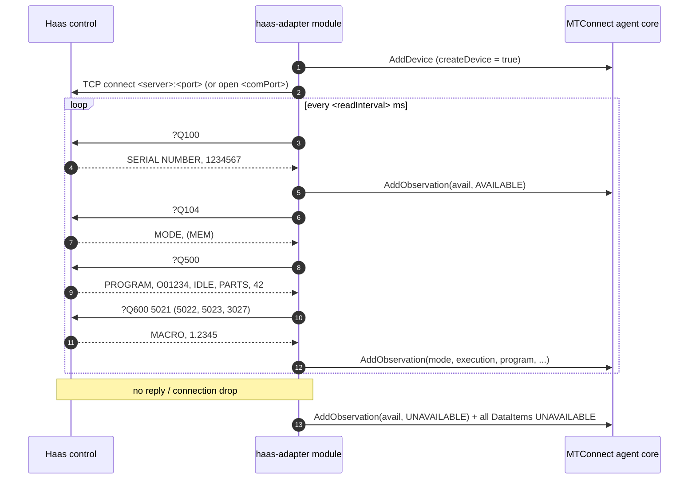

# Haas adapter

- **Module name** — MTConnect Haas Adapter agent module
- **Identifier** — `haas-adapter`
- **NuGet package** — `MTConnect.NET-AgentModule-HaasAdapter`
- **Source path** — `agent/Modules/MTConnect.NET-AgentModule-HaasAdapter/`

## Purpose

Reads a Haas CNC control directly over Ethernet or RS-232 using Haas Q-commands (`?Q100`, `?Q104`, `?Q500`, `?Q600`) and feeds the results into the agent, so no separate adapter process is needed. By default the module also adds a Device model containing the DataItems it reports.

## Configuration schema

The module's configuration class is `HaasAdapterModuleConfiguration`. The keys below describe the YAML map under `haas-adapter:`.

| Key | Type | Default | Permissible values | Notes |
| --- | --- | --- | --- | --- |
| `deviceKey` | string | `null` | device name or UUID | Required. The Device observations are added to. |
| `createDevice` | bool | `true` | `true`, `false` | When `true`, the module adds a Device named `deviceKey` with the DataItems below. Set `false` to use a Device from `Devices.xml`. |
| `deviceUuid` | string | `deviceKey` | any string | UUID of the Device created when `createDevice` is `true`. |
| `connection` | string | `ethernet` | `ethernet`, `serial` | How the module connects to the control. |
| `readInterval` | int | `1000` | milliseconds | Delay between read cycles. |
| `responseTimeout` | int | `2000` | milliseconds | Maximum time to wait for a reply to a command. A timeout closes the connection; it is reopened on the next cycle. |
| `units` | string | `mm` | `mm`, `inch` | The units the control reports positions in (Setting 9). Inch values are converted to millimeters. |
| `server` | string | `localhost` | hostname or IP address | Ethernet only. |
| `port` | int | `5051` | 1-65535 | Ethernet only. The control's Q-command port (Setting 143). |
| `connectionTimeout` | int | `5000` | milliseconds | Ethernet only. Maximum time to wait for the TCP connection to open. |
| `comPort` | string | `COM1` | port name | Serial only (ex. `COM1`, `/dev/ttyUSB0`). |
| `baudRate` | int | `19200` | baud rate | Serial only. Must match Setting 11. |
| `parity` | string | `None` | `None`, `Even`, `Odd`, `Mark`, `Space` | Serial only. Must match Setting 12. |
| `dataBits` | int | `7` | `7`, `8` | Serial only. Must match Setting 13. |
| `stopBits` | int | `1` | `1`, `2` | Serial only. |

## DataItems

When `createDevice` is `false`, the Device in `Devices.xml` needs DataItems whose `id` or `name` match these keys.

| Key | DataItem | Source |
| --- | --- | --- |
| `avail` | `AVAILABILITY` | `AVAILABLE` while the control replies to `?Q100`; otherwise `UNAVAILABLE` (and every other DataItem is set `UNAVAILABLE`). |
| `mode` | `CONTROLLER_MODE` | `?Q104` — MEM / DNC = `AUTOMATIC`, MDI = `MANUAL_DATA_INPUT`, JOG / ZERO RET = `MANUAL`, EDIT = `EDIT`. |
| `execution` | `EXECUTION` | `?Q500` — IDLE = `READY`, BUSY = `ACTIVE`, FEED HOLD = `INTERRUPTED`, ALARM ON = `STOPPED`. |
| `program` | `PROGRAM` | `?Q500` — empty in MDI. |
| `partCount` | `PART_COUNT` | `?Q500` — the M30 counter. |
| `system` | `SYSTEM` condition | `?Q500` — `FAULT` while ALARM ON, otherwise `NORMAL`. |
| `x_act`, `y_act`, `z_act` | `POSITION` (`ACTUAL`) | `?Q600 5021` / `5022` / `5023` — machine position, millimeters. |
| `speed` | `ROTARY_VELOCITY` (`ACTUAL`) | `?Q600 3027` — spindle speed, RPM. |

## Wire interaction



Replies framed with STX / ETB control characters and replies followed by the `>` prompt are both accepted.

## Example configuration

```yaml
modules:
  - haas-adapter:
      deviceKey: VF2
      server: 192.168.1.60
      port: 5051
      units: inch
```

Over RS-232:

```yaml
modules:
  - haas-adapter:
      deviceKey: VF2
      connection: serial
      comPort: COM1
      baudRate: 19200
      parity: None
      dataBits: 7
```

For multiple machines, declare the module once per machine. Created DataItem IDs are prefixed with the Device name, so they do not collide.

## Troubleshooting

- **Always `UNAVAILABLE`** — check that the control's Q-commands are enabled and the port matches Setting 143. Set the `modules.haas-adapter` logger to `Debug` to see connection and reply details (`Trace` logs every command and reply).
- **Program and part count only change when the program stops** — the control replies `STATUS, BUSY` to `?Q500` while running and does not report them in that state.
- **Positions off by a factor of 25.4** — set `units` to match Setting 9.
- **Observations dropped with `createDevice: false`** — the Device's DataItem `id` or `name` must match the keys above; verify against `/probe`.

## API reference

- [`HaasAdapterModuleConfiguration`](/api/MTConnect.Configurations.HaasAdapterModuleConfiguration) — the module's configuration class.
- [`HaasResponse`](/api/MTConnect.Haas.HaasResponse) — the Q-command reply parser.
