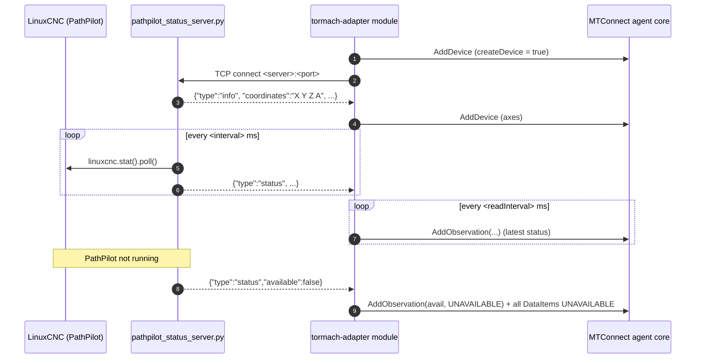

# Tormach adapter

- **Module name** — MTConnect Tormach Adapter agent module
- **Identifier** — `tormach-adapter`
- **NuGet package** — `MTConnect.NET-AgentModule-TormachAdapter`
- **Source path** — `agent/Modules/MTConnect.NET-AgentModule-TormachAdapter/`

## Purpose

Reads Tormach CNC machines running PathPilot. PathPilot is based on LinuxCNC and has no network interface for machine data, so the module comes with a **PathPilot status server** (`pathpilot/pathpilot_status_server.py`). The status server runs on the controller, reads the machine status with the LinuxCNC Python API (`linuxcnc.stat`), and streams it to the module over TCP as JSON lines. The module builds a Device from the axes configured in PathPilot.

The status server only reads status; it never sends commands to the machine.

## PathPilot status server

1. Copy `pathpilot_status_server.py` (in the `pathpilot` folder next to the agent) to the PathPilot controller, for example with the controller's network file share or a USB drive.
2. Run it on the controller: `python pathpilot_status_server.py` (options: `--port`, default `7890`; `--bind`; `--interval`, default `500` ms). It uses only Python and the `linuxcnc` module included with PathPilot.
3. To start it automatically, add it to the controller's startup applications. It reports `UNAVAILABLE` while PathPilot is not running.

::: warning PathPilot updates
PathPilot updates may remove files and startup entries added to the controller. Check the status server is running after updating PathPilot.
:::

Messages (one JSON object per line):

```json
{"type":"info","version":"1.0","machine":"tormach_mill_1100","coordinates":"X Y Z A","linear_units":0.03937}
{"type":"status","available":true,"task_mode":"AUTO","task_state":"ON","interp_state":"READING","estop":false,"file":"/home/operator/gcode/bracket.nc","line":120,"tool":5,"g5x_index":1,"actual_position":[1.5,-2.25,0.1,90.5,0,0,0,0,0], ...}
```

## Configuration schema

The module's configuration class is `TormachAdapterModuleConfiguration`. The keys below describe the YAML map under `tormach-adapter:`.

| Key | Type | Default | Permissible values | Notes |
| --- | --- | --- | --- | --- |
| `deviceKey` | string | `null` | device name or UUID | Required. The Device observations are added to. |
| `createDevice` | bool | `true` | `true`, `false` | When `true`, the module adds a Device named `deviceKey`, updated with the machine name and axes configured in PathPilot. Set `false` to use a Device from `Devices.xml`. |
| `deviceUuid` | string | `deviceKey` | any string | UUID of the Device created when `createDevice` is `true`. |
| `server` | string | `localhost` | hostname or IP address | The PathPilot controller. |
| `port` | int | `7890` | 1-65535 | The status server port. |
| `readInterval` | int | `500` | milliseconds | Interval between processing the status received. |
| `connectionTimeout` | int | `5000` | milliseconds | Maximum time to wait for the connection to open. |
| `dataTimeout` | int | `5000` | milliseconds | Time without data after which the connection is reopened. |
| `workPositions` | bool | `false` | `true`, `false` | Also report work coordinate positions. |

## DataItems

When `createDevice` is `false`, the Device in `Devices.xml` needs DataItems whose `id` or `name` match these keys.

| Key | DataItem | Source (`linuxcnc.stat`) |
| --- | --- | --- |
| `avail` | `AVAILABILITY` | `AVAILABLE` while PathPilot is running and the status server is connected; otherwise every DataItem is `UNAVAILABLE`. |
| `estop` | `EMERGENCY_STOP` | `estop` |
| `mode` | `CONTROLLER_MODE` | `task_mode` — AUTO = `AUTOMATIC`, MDI = `MANUAL_DATA_INPUT`, MANUAL = `MANUAL`. |
| `execution` | `EXECUTION` | `interp_state` — IDLE = `READY`, READING / WAITING = `ACTIVE`, PAUSED = `FEED_HOLD`; `STOPPED` in emergency stop or with the machine off. |
| `program` | `PROGRAM` | `file` — the file name. |
| `line` | `LINE_NUMBER` (`ABSOLUTE`) | `current_line` |
| `tool` | `TOOL_NUMBER` | `tool_in_spindle` |
| `workOffset` | `WORK_OFFSET` | `g5x_index` — ex. `54`, `59.1`. |
| `optionalStop` | `CONTROLLER_MODE_OVERRIDE` (`OPTIONAL_STOP`) | `optional_stop` |
| `feedrate` | `PATH_FEEDRATE` (`ACTUAL`) | `current_vel` — mm/s. |
| `feedOverride` | `PATH_FEEDRATE_OVERRIDE` (`PROGRAMMED`) | `feedrate` — percent. |
| `rapidOverride` | `PATH_FEEDRATE_OVERRIDE` (`RAPID`) | `rapidrate` — percent. |
| `speed` | `ROTARY_VELOCITY` (`COMMANDED`) | spindle speed — RPM, 0 when the spindle is off. |
| `spindleOverride` | `ROTARY_VELOCITY_OVERRIDE` | spindle override — percent. |
| `{axis}_act` | `POSITION` / `ANGLE` (`ACTUAL`) | `actual_position` — machine position, mm (inch converted) or degrees. |
| `{axis}_work` | `POSITION` / `ANGLE` (`ACTUAL`) | `actual_position` minus the work, G92 and tool offsets, when `workPositions` is `true`; references the Device's `work` coordinate system (type `OBJECT`). |

Not reported: alarms (PathPilot errors are only on the LinuxCNC error channel, and reading it would take them away from PathPilot), part counts (not part of the LinuxCNC status), and the measured spindle speed.

## Wire interaction



## Example configuration

```yaml
modules:
  - tormach-adapter:
      deviceKey: PCNC1100
      server: 192.168.1.80
      port: 7890
      workPositions: true
```

For multiple machines, declare the module once per machine. Created DataItem IDs are prefixed with the Device name, so they do not collide.

## Troubleshooting

- **Always `UNAVAILABLE`, connection failed** — the status server is not running, or the port is blocked. Run it in a terminal on the controller to see its output.
- **`UNAVAILABLE` while connected** — the status server is running but PathPilot (LinuxCNC) is not.
- **Positions off by a factor of 25.4** — check `linear_units` in the `info` message; positions are converted using the PathPilot machine units.
- **Missing after a PathPilot update** — reinstall the status server and its startup entry.
- **Observations dropped with `createDevice: false`** — the Device's DataItem `id` or `name` must match the keys above; verify against `/probe`.

## API reference

- [`TormachAdapterModuleConfiguration`](/api/MTConnect.Configurations.TormachAdapterModuleConfiguration) — the module's configuration class.
- [`TormachMessageParser`](/api/MTConnect.Tormach.TormachMessageParser) — parses the status server messages.
